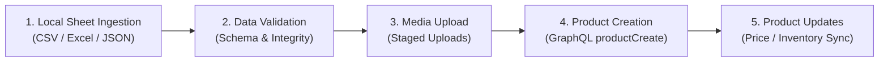

# Shopify Automation Bot - Agent & Developer Guide

Repository For **Shopify Automation Bot** built with Shopify App template, React Router, Node.js, and Prisma. The application automates product catalog workflows from local spreadsheets to a Shopify store.

---

## Shopify AI Toolkit & Platform Rules

Use the [Shopify AI Toolkit](https://shopify.dev/docs/apps/build/ai-toolkit) for all Shopify API and platform work. If missing, install it in the agent host per that page (or `npx skills add Shopify/shopify-ai-toolkit --list` for skill-compatible hosts) — do not add tooling to this repo.

Shopify Dev MCP is pre-configured in `.mcp.json` (`@shopify/dev-mcp@latest`) to assist agents with live Shopify API queries, schema lookups, and best practices.

---

## Core Automation Functions

The bot provides automated product management pipeline with five key capabilities:



### 1. Reads from Sheet (Locally on Device)
- Ingests product catalog spreadsheets stored locally on device (supported formats: CSV, XLSX / Excel, TSV, or exported sheet dumps).
- Extracts core attributes: Title, Description, Vendor, Product Category, Tags, SKU, Barcode, Pricing (price & compare-at price), Inventory quantities, Variants/Options (Size, Color, etc.), and Image paths/URLs.

### 2. Check and Validates Data
- Performs strict pre-flight validation before any Shopify API calls:
  - **Required fields check**: Ensures `Title`, `Price`, and required variant dimensions are populated.
  - **Data type & format verification**: Validates numeric values (prices ≥ 0, inventory counts as integers), barcode formats, and SKU conventions.
  - **Duplicate detection**: Flags duplicated SKUs or conflicting handles in the input dataset.
  - **Media integrity**: Confirms local media file paths exist or remote image URLs are well-formed and accessible.
  - **Error reporting**: Generates actionable validation error logs indicating row numbers and offending columns without crashing the import batch.

### 3. Upload Media
- Automates media asset management using Shopify GraphQL Admin API:
  - Uses `stagedUploadsCreate` mutation to generate temporary signed upload URLs for local images/files.
  - Uploads media binaries to the staged target.
  - Attaches uploaded assets to products via `fileCreate` or directly through `productCreate` / `productCreateMedia` input structures.
  - Verifies media status (`READY` / `FAILED`) before proceeding with product publishing.

### 4. Create Products
- Creates new products in the store using Admin GraphQL mutations (`productCreate` or `productSet`):
  - Sets titles, HTML descriptions, product types, vendors, and status (`ACTIVE` or `DRAFT`).
  - Creates multi-variant structures (options, pricing, SKUs, barcodes, weight, requires shipping).
  - Associates uploaded media assets and assigns alt text.
  - Initializes inventory levels across designated store locations (`inventoryItem` / `inventoryAdjustQuantities`).
  - Attaches custom metafields (e.g., `$app:demo_info` or custom specifications).

### 5. Update Products
- Updates and synchronizes existing products in the store:
  - Looks up existing items via SKU, Barcode, or Shopify Product ID / Handle.
  - Performs partial or full updates via `productUpdate` and `productVariantsBulkUpdate`.
  - Updates prices and promotional compare-at prices.
  - Synchronizes inventory levels without overriding unrelated variant details.
  - Subscribes to real-time webhook events (`/webhooks/products/update`) to track and reconcile price or variant changes in the store.

---

## Repository Structure

```
product-automation/
├── AGENTS.md                  # Agent and developer instruction manual
├── CLAUDE.md                  # Assistant reference (points to AGENTS.md)
├── README.md                  # Upstream Shopify app template documentation
├── shopify.app.toml           # Shopify app manifest (scopes, webhooks, metafields)
├── shopify.web.toml           # Web process configuration for Shopify CLI
├── package.json               # Project dependencies and script definitions
├── tsconfig.json              # TypeScript compiler configuration
├── vite.config.ts             # Vite configuration with React Router plugin
├── Dockerfile                 # Containerized deployment specification
├── .mcp.json                  # Model Context Protocol setup (@shopify/dev-mcp)
├── prisma/
│   ├── schema.prisma          # Database schema (SQLite session storage)
│   └── migrations/            # Database migration history
└── app/
    ├── shopify.server.ts      # Shopify API server initialization and auth helpers
    ├── db.server.ts           # Prisma client singleton instance
    ├── routes.ts              # React Router v7 routes definition
    ├── root.tsx               # Root application layout and HTML document shell
    ├── entry.server.tsx       # Server-side rendering entry point
    └── routes/
        ├── app.tsx            # Main app shell with Polaris / App Bridge providers
        ├── app._index.tsx     # Embedded admin dashboard & product action examples
        ├── app.additional.tsx # Sample secondary page for App Bridge navigation
        ├── auth.$.tsx         # OAuth authentication and callback routes
        ├── webhooks.app.uninstalled.tsx    # App uninstall webhook handler
        ├── webhooks.app.scopes_update.tsx  # Scopes update webhook handler
        └── webhooks.products.update.tsx    # Product update webhook handler
```

---

## Developer Commands & Workflow

All commands are executed using `npm`:

### Setup & Database
| Command | Description |
| :--- | :--- |
| `npm install` | Install all dependencies |
| `npm run setup` | Generate Prisma client and apply database migrations (`prisma generate && prisma migrate deploy`) |
| `npm run prisma -- <command>` | Run Prisma CLI commands (e.g. `npm run prisma studio`, `npm run prisma migrate dev`) |

### Development & Local Server
| Command | Description |
| :--- | :--- |
| `npm run dev` | Launch the Shopify CLI dev environment (starts Vite server, cloudflare tunnel, and syncs app config) |
| `npm run build` | Build the production application bundle via React Router |
| `npm run start` | Start the production server with `react-router-serve` |
| `npm run docker-start` | Run `setup` followed by `start` (used for Docker containers) |

### Code Quality & Types
| Command | Description |
| :--- | :--- |
| `npm run typecheck` | Run React Router type generation and TypeScript compiler check (`react-router typegen && tsc --noEmit`) |
| `npm run lint` | Run ESLint with cached results across the codebase |
| `npm run graphql-codegen` | Generate TypeScript types for Shopify GraphQL operations |

### Shopify CLI Operations
| Command | Description |
| :--- | :--- |
| `npm run config:link` | Link the workspace to an existing Shopify Partner app |
| `npm run config:use` | Switch between Shopify app configurations |
| `npm run env` | Inspect current environment variables provided by Shopify CLI |
| `npm run deploy` | Deploy app extensions and configuration to Shopify |
| `npm run generate` | Scaffold new Shopify extensions (theme, UI, functions) |

---

## Shopify Configuration & Permissions

The bot operates under permissions defined in `shopify.app.toml`:

### Access Scopes
```toml
scopes = "read_files,write_files,write_inventory,read_inventory,read_products,write_products"
```
- **`read_files`, `write_files`**: Required for media uploads via Staged Uploads and Files API.
- **`read_products`, `write_products`**: Required for reading, creating, and updating products, variants, and collections.
- **`read_inventory`, `write_inventory`**: Required for reading and updating stock levels across locations.

### Webhook Subscriptions
- `app/uninstalled` (`/webhooks/app/uninstalled`)
- `app/scopes_update` (`/webhooks/app/scopes_update`)
- `Product` update events (`/webhooks/products/update`): Triggered on `product.variants.price` and `product.variants.compareAtPrice` changes for active products.

---

## Guidelines for AI Agents

1. **GraphQL Best Practices**:
   - Always check `userErrors` on GraphQL mutations (`productCreate`, `productUpdate`, `fileCreate`, `stagedUploadsCreate`). Never assume HTTP 200 means business logic success.
   - Use GraphQL query fragments and request only the fields necessary to reduce query cost.
   - Respect Shopify API rate limits (GraphQL bucket leak rate) by chunking batch imports and handling throttled responses.
2. **Local Sheet Processing**:
   - Keep file parsing modular and separated from Shopify API execution.
   - Validate and sanitize sheet rows into a standardized intermediate schema before triggering uploads or mutations.
   - Maintain a local sync status or log file to support resuming interrupted batches.
3. **Preserving App Architecture**:
   - Adhere to React Router v7 standards and the official `@shopify/shopify-app-react-router` SDK conventions.
   - Do not commit secrets or tokens. Session tokens are managed securely in Prisma SQLite (`prisma/schema.prisma`).
